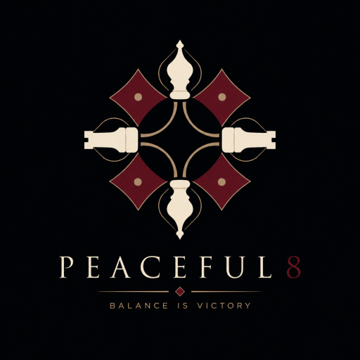

# Peaceful 8

## Projektübersicht

Peaceful 8 ist ein plattformübergreifendes Logikspiel auf Basis eines klassischen Schachbretts.

Der Spieler platziert acht Schachfiguren (Dame, Turm, Läufer, Springer) so auf einem 8x8-Brett, dass keine Figur eine andere Figur angreifen kann.

Das Ziel ist eine friedliche Anordnung aller Figuren.

## Kernidee

"Eight pieces. Zero conflicts." - "Balance is Victory."

Das Spiel kombiniert:
- Schachlogik
- Logikrätsel
- Puzzle-Generierung
- entspannte Spielerfahrung

## Plattformen

- Web Browser
- Progressive Web App
- Android
- iOS

## Dokumentation

- [Produktvision](.docs/VISION.md) 
- [Spielmechanik](.docs/GAME_DESIGN.md)
- [technische Architektur](.docs/ARCHITECTURE.md)
- [Level und Generator](.docs/LEVEL_SYSTEM.md)
- [Projektübersicht](.docs/PROJECT_OVERVIEW.md) 
- [Roadmap](.docs/DEVELOPMENT_PLAN.md)